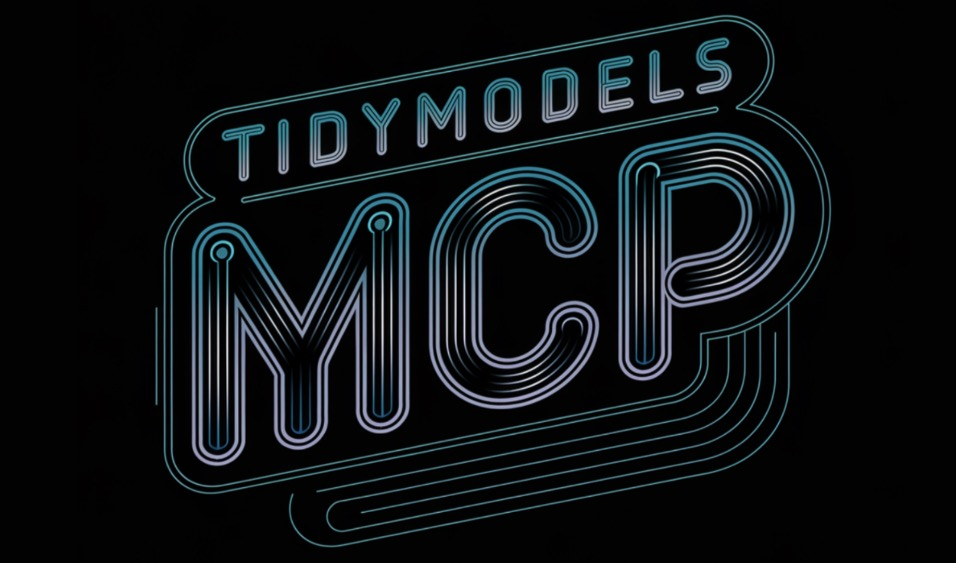

<!-- tidymodels-mcp-preview.jpg is the preview image in this folder. -->

{.preview-image}

# The gap I filled in March 2025 is closed

Early on I was super hungry to test and adopt the [Model Context Protocol](https://modelcontextprotocol.io/){target="_blank"} (MCP) for the work I do every week, ML engineering and AI ops.

In March 2025, coding agents had basically zero tidymodels-specific guidance, so I built a local server. The tidymodels team has since closed that gap.

# What the server did, and why it made sense then

[tidymodels-mcp](https://github.com/JavOrraca/tidymodels-mcp){target="_blank"} is a small Node server. I paired it with [Cline](https://cline.bot/){target="_blank"} and [Claude Desktop](https://claude.ai/download){target="_blank"}. It read the public repos under the [tidymodels organization](https://github.com/tidymodels){target="_blank"}.

Five tools, and that was the product:

- `list_tidymodels_packages` listed org repositories it treated as R packages. The list was cached for an hour, with an optional refresh.
- `get_package_details` pulled a repo's DESCRIPTION and a README excerpt from GitHub.
- `search_r_functions` searched `.R` files in the org and tried to return matching roxygen blocks.
- `search_issues` searched issues, with an optional repo and an optional state (open, closed, or all).
- `generate_tidymodels_code` returned a template: recipe, model, tune, or evaluation.

That shape made sense at the time. An agent could ask what lives in parsnip, or find a function, without me pasting docs into the chat. An optional GitHub token was only there to stay under the API rate limit.

The modeling advice was a snapshot. `generate_tidymodels_code` returned string templates I wrote that month. The last push to the repo was March 22, 2025.

# Why I archived it

The tidymodels team now publishes official agent skills and a maintained function catalog. Posit ships R packages that connect an agent to a live R session. Those are the people who change the framework. They should own the instructions an agent follows.

A copy I kept alive would go stale every time [parsnip](https://parsnip.tidymodels.org/){target="_blank"} or [recipes](https://recipes.tidymodels.org/){target="_blank"} ships. The package list can refresh from GitHub. The templates cannot. They still tell an agent how to model in the idiom of March 2025.

The repo is archived. If you pinned it, unpin it.

# Use the official pieces

I recommend four things, in this order. Skills for how to model. The catalog when you need a function. A live session when the agent should see your data. The framework site, and the release blog, when you want to know what just shipped.

## Skills in Claude Code

Start at [skills.tidymodels.org](https://skills.tidymodels.org/){target="_blank"} and the [tidymodels/skills](https://github.com/tidymodels/skills){target="_blank"} repo. The user plugin is for analysis. The developer plugin is for extending the ecosystem: custom metrics, recipe steps, dials parameters, parsnip models and engines.

These install lines are the current [README](https://github.com/tidymodels/skills/blob/main/README.md){target="_blank"} form. Add the `tidymodels/skills` marketplace, then install the two plugins from `tidymodels-skills`. Both are in the marketplace at version 0.5.0, including the user skill for tabular modeling.

```text
/plugin marketplace add tidymodels/skills
/plugin install tidymodels-developers@tidymodels-skills
/plugin install tidymodels-users@tidymodels-skills
```

I install the user plugin for day-to-day modeling. I install the developer plugin when I am writing an extension, not when I am fitting a model on a client dataset.

## The function catalog

[tidymodels.org/find](https://www.tidymodels.org/find/){target="_blank"} is the lookup my server was imitating. Searchable tables of packages and functions, with links into the reference docs: parsnip models, prediction types, recipe steps, broom methods, sparse methods, tidyclust.

The tidymodels team maintains that table, and they update it when the packages change.

## A live R session, with btw and mcptools

[btw](https://posit-dev.github.io/btw/){target="_blank"} and [mcptools](https://posit-dev.github.io/mcptools/){target="_blank"} connect an agent to R that is actually running. My server could quote a README. It could not see the data frame in the session.

```{r}
#| eval: false
# CRAN installs, as documented for btw and for mcptools 1.0.0
install.packages("btw")
install.packages("mcptools")
```

`btw()` copies context from the open session (a data frame, a help page, a question) so you can paste it into a chat. `btw_app()` is a chat inside the IDE. `btw_mcp_server()` exposes btw's tools to an external agent over MCP.

The btw site also documents a development install with pak:

```{r}
#| eval: false
# Development version of btw, as documented
# install.packages("pak")
pak::pak("posit-dev/btw")
```

[mcptools 1.0.0](https://opensource.posit.co/blog/2026-07-06_mcptools-1-0-0/){target="_blank"} is the R SDK for MCP. It hosts R functions as tools, and it fetches tools from a remote server back into R. Hosting includes Posit Connect.

Simon Couch's release post is the walkthrough I would follow. The server file it shows is short:

```yaml
engine: mcptools
tools: tools.R
```

```{r}
#| eval: false
# Documented Posit Connect deploy from the mcptools 1.0.0 post
rsconnect::deployAPI(".", contentCategory = "mcp")
```

Use btw when you want the current session in the conversation. Use mcptools when you want an R function to be a tool, including one you deploy.

## The framework, and where releases land

The framework itself is still [tidymodels.org](https://www.tidymodels.org/){target="_blank"}.

```{r}
#| eval: false
install.packages("tidymodels")
```

Release notes land on the [Posit Open Source blog](https://opensource.posit.co/blog/){target="_blank"} and the [tidyverse blog](https://www.tidyverse.org/blog/){target="_blank"}, and I read both when parsnip or recipes ships. I also hear about a lot of package updates from open source devs I follow on LinkedIn.

# The templates taught agents to leak

This is the reason I would rather archive the old tool than leave it looking current.

The [tidymodels user skill](https://github.com/tidymodels/skills/blob/main/users/tabular-data-ml/SKILL.md){target="_blank"} keeps the test set sealed until you explicitly allow it. During development it tells the agent never to predict on the test data, never to calculate a test metric, and never to use the test set to compare models or tune.

When development is finished, the skill has to ask, in the conversation, whether it may evaluate the final model on the test set. A `predict()` on the test data before that yes is an error. Checking the split with something like `nrow()` or `glimpse()` is the exception it allows.

It also refuses a metric from the rows the model just fit. Scores used to choose a model come from resampling. The skill uses 10-fold cross-validation on smaller data, and a validation set once you are around 10,000 rows or more.

Early in the process it proposes a simple regularized linear model (linear, logistic, or multinomial), then a boosted tree with early stopping (`stop_iter = 5`). Both are judged on those resamples.

The [tuning notes](https://github.com/tidymodels/skills/blob/main/users/tabular-data-ml/references/tuning.md){target="_blank"} call that linear model the simple one to propose first. The test set stays closed while you decide.

My templates taught the other habit. The default `generate_tidymodels_code` path, and the getting-started snippet, did this in one script: split, fit on the training rows, `predict()` on the test rows, print a metric. No resample in between.

The evaluation template did the same thing, and it called `set.seed(123)`. The user skill tells agents to avoid seeds like 123. Those values are overused, and they can line up by accident with someone else's analysis.

The tune template was the careful one of the set. It used `vfold_cv()`, then `tune_grid()`, then `fit()` on the training data, and it stopped. It sat next to templates that treated the holdout as the score you print next. An agent that stitches those examples together spends the test set while it is still choosing the model.

::: {.callout-tip}
## Leave the test set sealed
If an agent writes `predict()` on the test data while you are still comparing models, stop it. Ask for the resampled metric. Open the test set once, at the end, on purpose.
:::

The test set is data the model, and you, have not used to make decisions. When a metric on that holdout influences the next edit, the number has learned your choices.

It comes out higher than the model will score on rows nobody has peeked at. That optimistic number is data leakage. It is a bad reason to ship a model, and it is a bad pattern to leave in a template an agent will copy.

# Prefer the maintainer's guidance

I recommend maintainer-owned agent guidance over a personal shim. The skills, the catalog, and a live session stay current because the people who change the packages also change the instructions.

Archive the tool when upstream catches up. An unarchived repo still looks like the path. If you pinned `tidymodels-mcp`, unpin it and use the list above.

Thanks to the tidymodels team, and to the Posit folks who ship btw and mcptools. The standard I was hungry to try is in better hands.

# Learn more

- [tidymodels-mcp](https://github.com/JavOrraca/tidymodels-mcp){target="_blank"}. The archived server this post is about. Created March 20, 2025.
- [tidymodels skills](https://skills.tidymodels.org/){target="_blank"} and the [source repo](https://github.com/tidymodels/skills){target="_blank"}. User and developer skills. The README has the install lines.
- [User skill for tabular modeling](https://github.com/tidymodels/skills/blob/main/users/tabular-data-ml/SKILL.md){target="_blank"}. Test-set rules, resampling, and the simple model it proposes first. The [user guide](https://skills.tidymodels.org/users/){target="_blank"} is the same material on the docs site.
- [Function catalog](https://www.tidymodels.org/find/){target="_blank"}.
- [btw](https://posit-dev.github.io/btw/){target="_blank"} and [btw on CRAN](https://cran.r-project.org/package=btw){target="_blank"}.
- [mcptools](https://posit-dev.github.io/mcptools/){target="_blank"}, [mcptools on CRAN](https://cran.r-project.org/package=mcptools){target="_blank"}, and the [1.0.0 release post](https://opensource.posit.co/blog/2026-07-06_mcptools-1-0-0/){target="_blank"} by Simon Couch.
- [tidymodels](https://www.tidymodels.org/){target="_blank"} and the [Posit Open Source blog](https://opensource.posit.co/blog/){target="_blank"}.

---

Happy Saturday, and happy coding!

```{r}
#| eval: false
sessionInfo()
```
